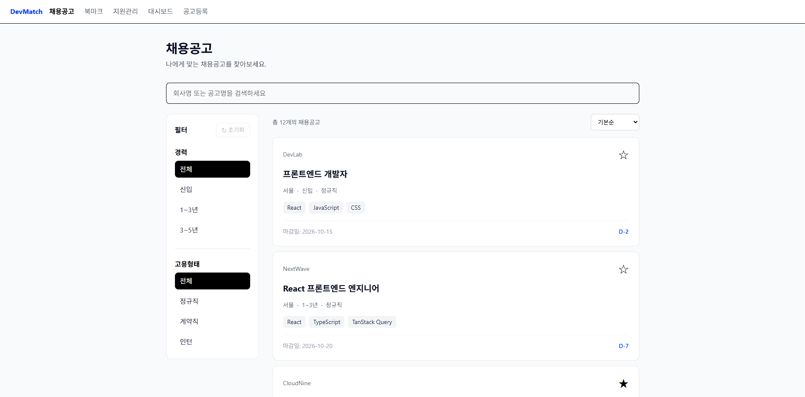
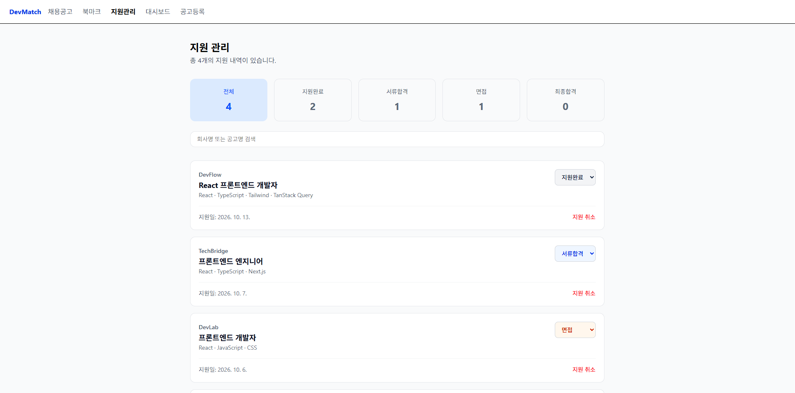
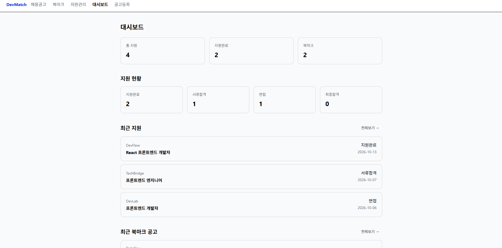

# DevMatch

DevMatch는 채용공고 검색부터 북마크, 지원 현황 관리까지 한 곳에서 할 수 있도록 만든 프론트엔드 채용 관리 서비스입니다.

채용공고를 검색하고 원하는 공고를 북마크할 수 있으며,
지원한 공고의 진행 상태를 관리하고 대시보드에서 지원 현황을 확인할 수 있습니다.

React와 TypeScript를 기반으로 구현했으며,
TanStack Query를 활용해 서버 상태를 관리하고
React Router의 URL Query Parameter를 활용해 검색 및 필터 상태 관리에 중점을 두었습니다.

---

## 개발 배경

실제 채용공고 API를 활용한 서비스를 목표로 시작한 프로젝트입니다.

외부 채용공고 API 연동을 계획했지만 API 사용 승인 전까지
프론트엔드 기능과 데이터 흐름을 먼저 구현하기 위해
json-server를 활용해 Mock REST API 환경을 구성했습니다.

추후 API 사용이 가능해지면 실제 채용공고 데이터와 연동할 예정입니다.

---

## 주요 화면

### 채용공고 조회



### 지원 관리



### 대시보드



---

## 주요 기능

### 채용공고 조회

- 채용공고 목록 조회
- 회사명 및 공고 제목 검색
- 경력 조건 필터
- 고용 형태 필터
- 마감일 기준 정렬

### 북마크

- 관심 채용공고 북마크 등록 및 취소
- 북마크한 공고 목록 조회

### 지원 관리

- 채용공고 지원 및 지원 취소
- 지원 상태 변경
  - 지원완료
  - 서류합격
  - 면접
  - 최종합격
- 회사명 및 공고 제목 검색
- 지원 상태별 필터

### 대시보드

- 전체 지원 수 확인
- 지원 상태별 현황 확인
- 북마크 수 확인
- 최근 지원 공고 확인
- 최근 북마크 공고 확인

### 채용공고 등록

- 새로운 채용공고 등록
- 기술 스택 입력
- 주요 업무 / 자격 요건 / 우대사항 입력
- 등록 완료 후 채용공고 목록 자동 갱신

---

## 기술 스택

### Frontend

- React
- TypeScript
- Vite
- Tailwind CSS
- React Router
- TanStack Query
- Axios

### Mock API

- json-server

---

## 주요 구현 내용

### 1. TanStack Query를 활용한 서버 상태 관리

채용공고, 북마크, 지원 내역 등의 서버 데이터를
TanStack Query를 사용해 관리했습니다.

지원, 북마크 등록/삭제, 지원 상태 변경처럼 서버 데이터가 변경되는 작업 이후에는
관련 Query를 무효화하여 최신 데이터를 다시 가져오도록 구성했습니다.

```ts
onSuccess: () => {
    queryClient.invalidateQueries({
        queryKey: ["applications"]
    });
}
```

이를 통해 서버 데이터를 변경한 뒤 클라이언트의 상태를 직접 수정하기보다
서버의 최신 데이터를 기준으로 화면이 다시 동기화되도록 했습니다.

### 2. URL Query Parameter를 활용한 검색 및 필터

검색어와 필터조건을 컴포넌트의 로컬 state에만 저장하면
새로고침하거나 페이지를 다시 방문 했을 때 기존 검색 조건이 사라지는 문제가 있었습니다.

이를 해결하기 위해 검색어, 경력, 고용 형태, 정렬 조건을
URL Query Parameter로 관리했습니다.

예시:

```text
/jobs?search=react&experience=신입&employmentType=정규직
```

이를 통해 검색 및 필터 조건이 URL에 남기 때문에 새로고침 후에도 조건을 유지할 수 있고
브라우저의 뒤로가기 / 앞으로가기와도 검색 상태가 연동되도록 구현했습니다.

### 3. 한글 IME 검색 입력 문제 해결

처음에는 검색창의 값을 URL Query Parameter와 직접 연결해
입력할 때마다 URL의 검색어가 변경되도록 구현했습니다.

하지만 한글을 입력할 때마다 URL이 변경되면서
입력 중인 한글 조합이 정상적으로 이루어지지 않는 문제가 발생했습니다.

이를 해결하기 위해 사용자가 입력 중인 값은 `searchInput`이라는 별도의 로컬 상태로 관리하고,
검색을 실행했을 때만 URL의 `search` 값을 변경하도록 수정했습니다.

```text
검색어 입력
    ↓
searchInput 변경
    ↓
검색 실행
    ↓
URL의 search parameter 변경
    ↓
공고 필터링
```

또한 브라우저의 뒤로가기 / 앞으로가기를 사용했을 때
URL만 변경되고 검색창의 값은 그대로 남아 있는 문제가 있었습니다.

이를 해결하기 위해 `popstate` 이벤트를 이용해
브라우저 히스토리가 변경될 때 URL의 검색어와 입력창의 값을 다시 동기화했습니다.

### 4. 북마크 로직을 Custom Hook으로 분리

북마크 기능은 채용공고 목록과 상세 페이지 등 여러 화면에서 사용되기 때문에
각 페이지에서 같은 로직을 반복해서 작성하지 않도록 `useBookmarks` Custom Hook으로 분리했습니다.

```text
useBookmarks
 ├─ 북마크 조회
 ├─ 북마크 추가
 ├─ 북마크 삭제
 └─ 북마크 토글
```

페이지에서는 북마크 데이터를 직접 관리하기보다
`useBookmarks`가 제공하는 데이터와 함수를 사용하도록 구성했습니다.

이를 통해 여러 페이지에서 동일한 북마크 로직을 재사용하고,
페이지 컴포넌트가 화면 구성에 더 집중할 수 있도록 했습니다.

### 5. 북마크 변경 시 발생한 전체 페이지 새로고침 문제 해결

북마크 기능을 구현하던 중 북마크를 등록하거나 삭제할 때마다
화면 전체가 새로고침되는 문제가 발생했습니다.

처음에는 TanStack Query의 `invalidateQueries` 과정에서 발생하는 문제라고 생각했지만,
확인해보니 json-server가 데이터를 저장하면서 `db.json`을 수정하고
Vite가 해당 변경을 소스 파일 변경으로 감지하면서 페이지를 다시 로드하고 있었습니다.

Vite 설정에서 `db.json`을 watch 대상에서 제외하여 문제를 해결했습니다.

```ts
server: {
    watch: {
        ignored: ["**/db.json"]
    }
}
```

이후 북마크를 등록하거나 삭제해도 전체 페이지가 새로고침되지 않고,
TanStack Query가 필요한 서버 데이터만 다시 요청하도록 수정했습니다.

---

## 개발 과정에서 배운 점

기존에는 React에서 데이터를 다룰 때 `useState`를 중심으로 생각하는 경우가 많았지만,
DevMatch를 개발하면서 클라이언트 상태와 서버 상태를 구분해서 관리하는 방법을 익혔습니다.

특히 TanStack Query를 적용하면서 서버 데이터를 직접 클라이언트 상태에 맞추기보다,
Query를 기준으로 서버와 화면을 다시 동기화하는 흐름을 이해할 수 있었습니다.

검색과 필터 기능을 구현하면서는 URL 역시 하나의 상태로 활용할 수 있다는 점을 배웠습니다.
단순히 검색 기능을 만드는 것에서 끝나지 않고,
한글 IME 입력과 브라우저 히스토리 동기화 과정에서 발생한 문제를 직접 확인하고 해결했습니다.

또한 기능이 늘어나면서 반복되는 UI는 컴포넌트로 분리하고,
여러 페이지에서 공유되는 로직은 Custom Hook으로 분리하면서
컴포넌트의 역할과 책임을 어떻게 나눌지 고민해볼 수 있었습니다.

---

## 향후 개선 사항

- Mock API를 실제 서버 API로 전환
- 로그인 및 사용자 인증
- 페이지네이션
- 채용공고 수정 및 삭제
- 로딩 UI 및 Error UI 개선
- 반응형 UI 개선
- 테스트 코드 작성
